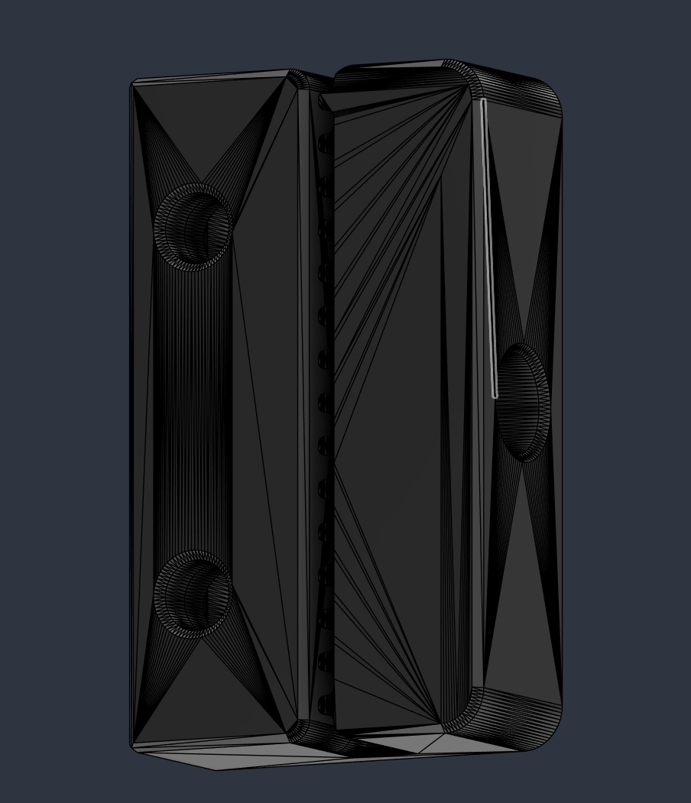

# ⬢ Clamping rear Z belt Attachment ⬢

This mod is a clamp for the rear Z belt. The original started slipping at like 300 print hours of ABS. And then my second one slipped at 200 hours.

Extremely lazy mod, I just modified the stl instead of the cad.

## Key Features

Clamping mechanism to prevent slippage.
 

## Bill of Materials (BOM)

Additional Hardware: 
    1x M3x12 BHCS Screw
    1x M3 Heatset Insert
